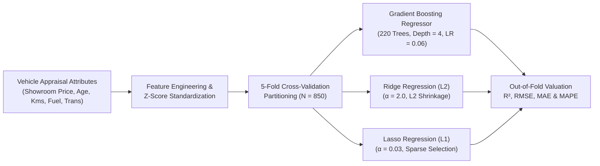
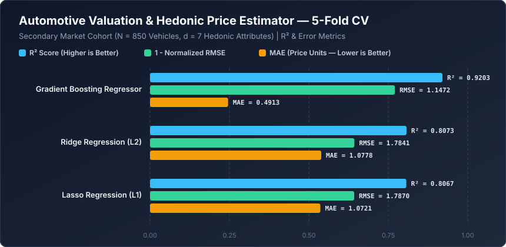

# Automotive Valuation & Hedonic Price Estimator


An econometric and machine learning valuation engine for **secondary-market automotive pricing**. Grounded in Rosen's Hedonic Pricing Theory, this repository benchmarks regularized linear estimators (**Ridge L2**, **Lasso L1**) against non-linear **Gradient Boosted Regression Trees** across $N = 850$ vehicles and 7 depreciation and specification covariates.

---

## Hedonic Valuation Pipeline



---

## Mathematical Formulation

### 1. Multiplicative Hedonic Depreciation Curve
Secondary-market resale value $P_{\text{resale}}$ decays exponentially with vehicle age $A$ and cumulative utilization $K$ (kilometers driven), modulated by discrete hedonic attribute multipliers $\mathbf{z} \in \{\text{Diesel}, \text{Automatic}, \text{Dealer}, \text{Owners}\}$:

$$P_{\text{resale}} = P_{\text{showroom}} \cdot \exp\left(-\lambda_A A - \lambda_K K\right) \cdot \left(1 + \boldsymbol{\gamma}^\top \mathbf{z}\right) + \varepsilon$$

Because additive linear models ($\hat{y} = \mathbf{w}^\top \mathbf{x} + b$) approximate this multiplicative relationship via a first-order hyperplane, they suffer systematic approximation bias on high-MSRP and high-mileage vehicles.

### 2. Regularized Linear Estimators vs. Stagewise Gradient Boosting
Ridge (L2) and Lasso (L1) minimize penalized squared-error objectives over standardized covariates $\tilde{\mathbf{X}}$:

$$\mathcal{L}_{\text{Ridge}}(\mathbf{w}) = \|\mathbf{y} - \tilde{\mathbf{X}}\mathbf{w}\|_2^2 + \alpha \|\mathbf{w}\|_2^2, \qquad \mathcal{L}_{\text{Lasso}}(\mathbf{w}) = \frac{1}{2N}\|\mathbf{y} - \tilde{\mathbf{X}}\mathbf{w}\|_2^2 + \alpha \|\mathbf{w}\|_1$$

Gradient Boosting directly captures the multiplicative interaction $P_{\text{showroom}} \times \exp(-\lambda_A A)$ by fitting shallow regression trees $h_m(\mathbf{x})$ to pseudo-residuals $r_{im} = y_i - F_{m-1}(\mathbf{x}_i)$ at each stage $m = 1, \dots, M$.

---

## Quantitative Benchmark Results

Evaluated via **5-Fold Cross-Validation** on $N = 850$ secondary-market vehicles across 7 hedonic attributes (`Present_Showroom_Price`, `Vehicle_Age_Years`, `Kilometers_Driven`, `Fuel_Diesel_Indicator`, `Transmission_Auto_Indicator`, `Seller_Dealer_Indicator`, `Previous_Owners`).



| Rank | Valuation Model | $R^2$ Score | RMSE | MAE | MAPE (%) |
| :--- | :--- | :---: | :---: | :---: | :---: |
| **1** | **Gradient Boosting Regressor** | **0.9203** | **1.1472** | **0.4913** | **17.24%** |
| **2** | **Ridge Regression (L2)** | 0.8073 | 1.7841 | 1.0778 | 49.25% |
| **3** | **Lasso Regression (L1)** | 0.8067 | 1.7870 | 1.0721 | 48.14% |

> **Econometric Takeaway:** Replacing additive linear regression (Ridge/Lasso $R^2 \approx 0.807$) with **Gradient Boosting** increases explained variance to **$R^2 = 0.9203$**, cuts Mean Absolute Error by **54.4%** ($1.0778 \to 0.4913$), and reduces Mean Absolute Percentage Error from $49.25\%$ to **$17.24\%$**.

---

## Repository Structure

```text
machine-learning-project-4/
├── assets/
│   └── benchmark_chart.svg          # Vector performance chart generated by benchmark.py
├── benchmarks/
│   └── benchmark_results.json       # Serialized 5-Fold CV valuation metrics
├── car_price_prediction.ipynb       # Exploratory hedonic pricing notebook
├── benchmark.py                     # Automated reproducible benchmark suite
└── README.md                        # Econometric formulation & benchmark documentation
```

---

## Quickstart & Reproducibility

### 1. Install Dependencies
```bash
pip install numpy scikit-learn jupyter
```

### 2. Run the Valuation Benchmark
```bash
python benchmark.py
```
Executes the 5-fold cross-validation benchmark, writes `benchmarks/benchmark_results.json`, and generates `assets/benchmark_chart.svg`.
